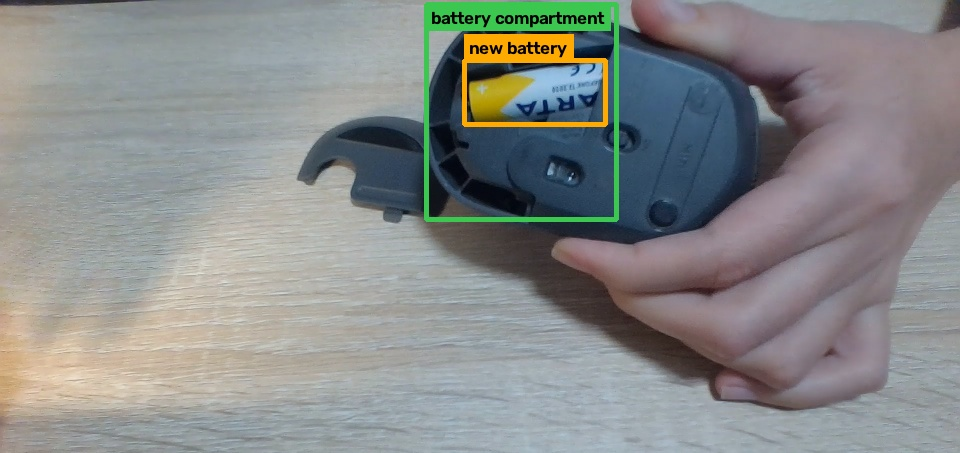

# Stepwise: turn a narrated video into a Standard Operating Procedure

Film a hands-on task once while explaining it, and Stepwise drafts a step-by-step
Standard Operating Procedure (SOP) with instructions, checks, warnings and annotated photos.
A person should review the draft before anyone relies on it.

Built for the Meta Global AI Developer Hackathon with Muse Voice Transcribe, Muse Spark and SAM 3.1.



*A photo from a generated SOP. Stepwise chose the frame, Muse Spark named the objects, and SAM 3.1 located them.*

## Why it matters

A lot of hands-on know-how is never written down. An experienced person can show a task in
a minute, but turning that into a clear procedure takes much longer. Stepwise starts from the
showing, so the first draft comes from how the work is actually done.

## How it works

| Stage | What runs | What it does |
|---|---|---|
| 1. Frames | Own code (OpenCV) | Samples the video at 2 frames per second |
| 2. Transcript | **Muse Voice Transcribe** | Turns the narration into timestamped text |
| 3. Grouping | **Muse Spark** | Groups the transcript into the real steps of the task |
| 4. Timing | Own code | Finds bursts of hand motion and merges them with the speech to place each step |
| 5. Keyframes | Own code | Picks a sharp, steady photo from the middle of each step |
| 6. Writing | **Muse Spark** | Reads the narration and photos, then writes the SOP and names the objects that matter |
| 7. Locating | **SAM 3.1** | Finds those objects and boxes them on each photo |
| 8. Export | Own code | Saves `sop.json`, annotated images and a self-contained `sop.html` |

Spark decides what matters in each photo, and SAM finds where it is. Speech and motion correct
each other: in the test video, motion alone finds 5 bursts because two of the 6 narrated steps
happen without a pause, so Stepwise splits that burst at its calmest moment.

Each real model response is cached in `cache/`, keyed on its inputs, so repeat runs don't pay
for the same calls again.

## Measured results

From one real run on one video: a 56-second recording of a wireless mouse battery replacement,
with 6 narrated steps.

| Measure | Result |
|---|---|
| Steps detected | 6 of 6, in the right order |
| Time overlap with hand-marked steps | 65–98% per step |
| Objects found by SAM 3.1 | 5 of the 13 that Spark named |
| Steps with no boxes | 2 of 6 (steps 4 and 6) |

See the full output in [`data/output/mouse/`](data/output/mouse/). `sop.html` displays once downloaded, or in the app.

## Limitations

- **Tested on one video only.** Its "step one, step two" narration is unusually easy, and natural narration is untested.
- **The SOP is a draft.** Spark can add details the video can't confirm, such as "until it clicks" or "sensor light glows".
- **SAM misses objects.** It didn't find the battery cover on any photo, and some boxes are looser than their labels suggest.
- **Filming matters.** Step timing assumes a fixed camera and short pauses between steps.
- **The crop is fixed.** The bottom 16% of every frame is removed, a value tuned for the test video.

## Not built yet

 The next goal is to report skipped or out-of-order steps, with a photo as evidence.

## Run it

You need Python 3.12. From the repo root, in PowerShell:

```powershell
python -m venv .venv
.venv\Scripts\activate
pip install -r requirements.txt
streamlit run src\app.py
```

The app shows the saved SOP without an API key or any API calls.

To create new SOPs, add a Meta Model API key to a `.env` file in the repo root. This uses credits.

```
MODEL_API_KEY=your_key_here
```

A **Create SOP** tab then appears in the app. You can also use the command line: save a video
as `data/videos/<name>.mp4`, then run `python src\sop.py <name>`. The test video isn't in the
repo because of its size.

## Built during the hackathon

All code in this repo was written during the Meta Global AI Developer Hackathon
(started 2026-11-02). The test video is my own footage. The app's visual style is using only real SOP data.
